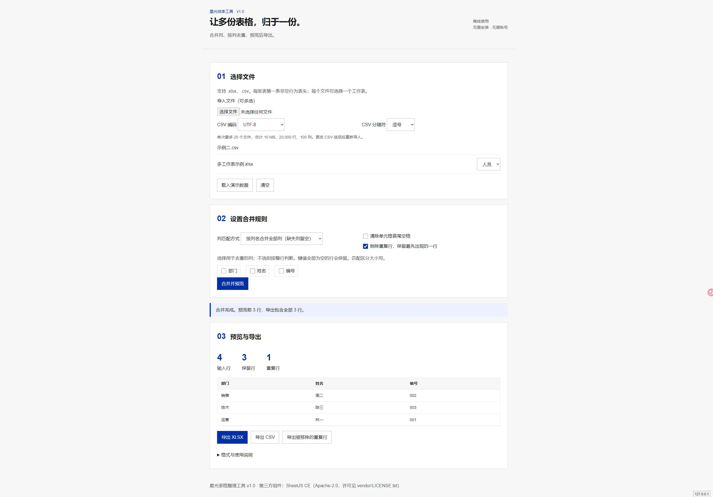

# 星光表格整理工具

面向日常办公的 Excel / CSV 合并与去重工具。由星光使用 AI 辅助开发。

**官方爱发电主页：[星光效率工具](https://afdian.com/a/autooffice)**

此仓库用于展示真实开发成果、公开演示和收集问题。完整离线包计划在爱发电以 **5 元/份**提供；当前尚未公开上架，自动交付等待平台认证。

## 实际界面

## 完整版功能

- 输入 .xlsx、.csv；每个 Excel 文件可选一个工作表。
- 按列名合并，自动匹配不同的列顺序；可选择严格要求列名一致。
- 按整行或指定列去重，保留首次出现的数据；空去重键保留。
- 预览前 100 行；导出全部结果和被移除的重复行。
- XLSX 文本导出，保留已有前导零；CSV 导出加入公式风险字符保护。
- 解压后用电脑 Chrome / Edge 打开 index.html；本地处理，无上传、无遥测。

## 支持范围

最多 20 个文件、总计 10 MB、20,000 行、100 列。仅处理显示文本，不保留格式、公式、图片或宏，不重新计算公式。不支持密码文件、复杂多行表头或手机端。

## 开源演示

下载 `demo.html` 后在浏览器打开。演示版支持粘贴两段制表符分隔文本、按同名列合并及整行去重；不包含 Excel 文件读写和完整版交付包。

## 已完成验证

业务逻辑测试覆盖 CSV 引号/换行、错误输入、重复表头、列顺序变化、严格/并集合并、空键、空格处理、前导零和公式字符串的 XLSX 往返。浏览器验证覆盖内置示例、CSV / XLSX 文件导入及结果预览。实际使用前仍请用文件副本核对结果。

## 反馈

可通过本仓库 Issues 或爱发电站内私信反馈。请只提供脱敏样例，不要上传客户资料、身份证、联系方式或业务机密。

公开演示代码见文件中的 MIT 许可。完整包及其第三方组件分别适用各自许可。
